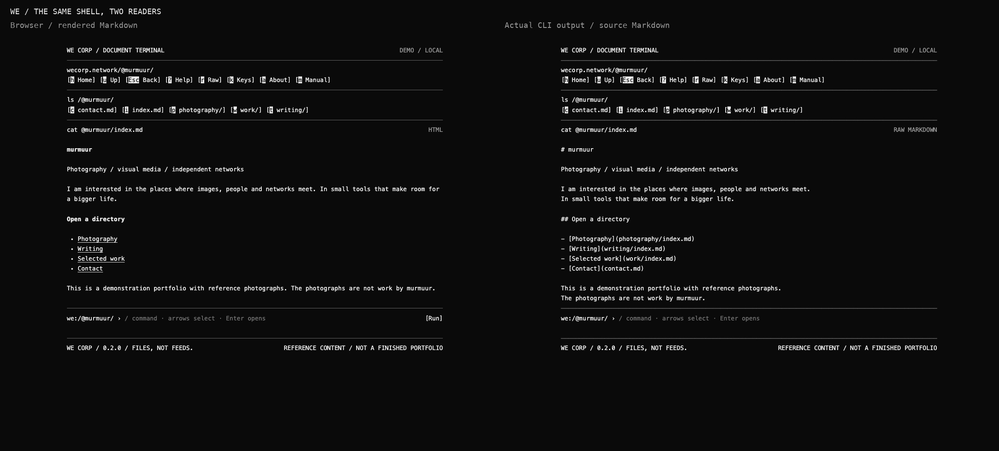
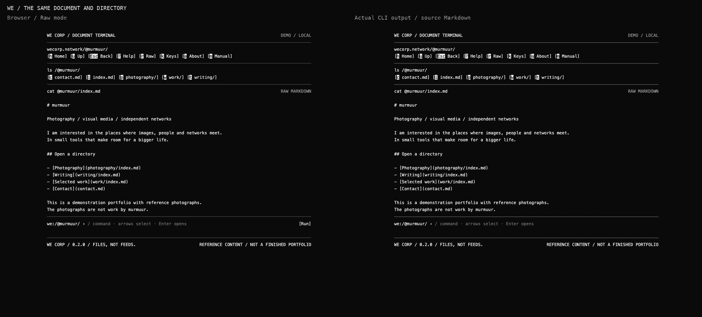
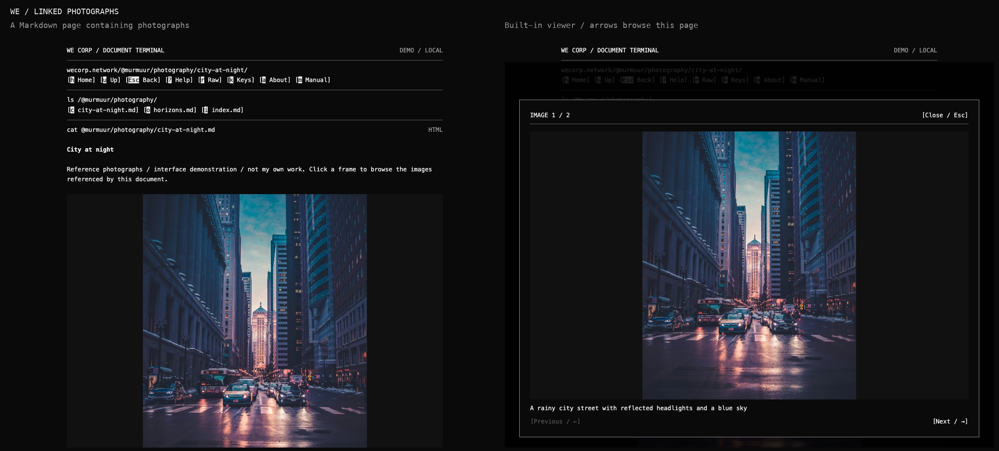
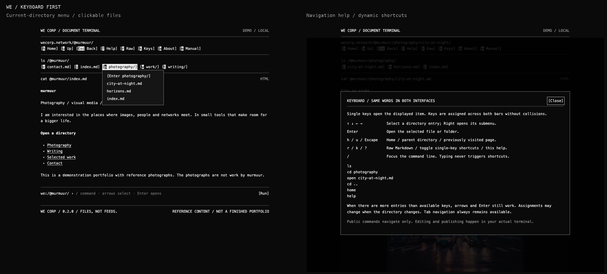
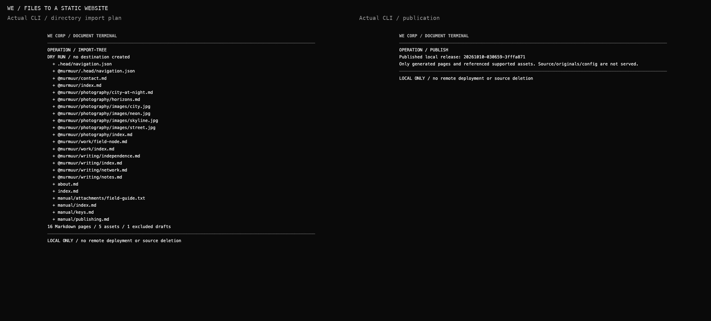

# WE Corp — files, not feeds

**A static website you manage from a terminal, built from ordinary Markdown and the files it references.**

WE explores a more independent relationship with technology: understandable tools, portable work, and the ability to leave. This repository is a working website prototype—not a deployed community network or a finished portfolio.

The browser and actual CLI share one document model and a grayscale terminal interface. At the top is your pinned navigation; below it is the current directory's `ls`; underneath is the document. The browser renders Markdown into HTML. The terminal shows its source.



## What it does

- Discovers Markdown pages and folders from an explicitly selected public directory.
- Rewrites relative links between documents into website URLs, keeping your folder organization.
- Provides clickable word controls, collision-free keyboard shortcuts, and arrows/Enter when the directory has more entries than available letters.
- Supports an optional `.head/navigation.json` for pinned links, ordering, text branding, and bounded directory submenus.
- Processes referenced photographs into responsive WebP copies, preserving source originals and removing camera metadata from public derivatives.
- Opens photographs in a keyboard-accessible viewer, following their order in the Markdown document.
- Copies supported linked downloads, but leaves unlinked assets out of the public build.
- Lets you create/edit documents, import photos, configure headers, validate, publish locally, and roll back from the CLI.

**There is no public shell or web editing API.** The website's command line navigates documents; it does not execute system commands.

## See the interface

### Raw Markdown in both readers

The browser's Raw mode displays the same source text as the terminal.



### Photography without turning everything into a platform

Reference an image in Markdown, then browse the page's photographs in the viewer. UI stays grayscale; photographs stay in color.



### Keyboard-first navigation

The displayed key is authoritative. When names conflict, another available key is assigned. Entries without a single key remain reachable through arrows, Enter, Tab, and clicks. Shortcuts pause while typing and can be disabled.



### Publish from the actual terminal

Directory import starts with a dry run. Publication stages a complete static release before switching the local active release. A failed build leaves the previous release selected.



Screenshots use clearly labeled sample writing and Unsplash reference photographs, **not murmuur's original photography or finished portfolio**. CLI panels render actual recorded Rich output; they are not native terminal-window screenshots. [Image sources and credits](docs/image-credits.md).

## Try it locally

Requires **Python 3.11+ and [uv](https://docs.astral.sh/uv/)**. Development is tested on macOS; CLI input uses POSIX terminal APIs. Windows is not qualified.

```sh
git clone https://github.com/murmuur22/wecorp.git
cd wecorp
uv sync --locked
uv run python setup_explorer_demo.py --download-photos
uv run python explorer.py preview --port 8768
```

The demo command explicitly downloads reference photographs from Unsplash, creates example Markdown, and builds the site. It refuses to overwrite an existing demo tree. Source photographs and generated workspaces are local and Git-ignored—not bundled in this repository.

Open **http://127.0.0.1:8768/** or **http://127.0.0.1:8768/@murmuur/** on the machine running the preview. The server binds only to loopback.

In another terminal:

```sh
uv run python explorer.py shell /@murmuur/
```

### Keys

- Displayed item key: open a page or directory.
- Arrows + Enter: select/open directory entries.
- `h`: Home; `u`: parent directory; Escape: Back.
- `?`: Help; `r`: raw/rendered; `k`: toggle single-letter shortcuts.
- `/`: enter a command; `q`: quit the real terminal.
- Image viewer: left/right browse; Escape closes and restores focus.

## Author ordinary files

```text
public/
├── index.md
├── about.md
├── .head/navigation.json
└── @murmuur/
    ├── index.md
    ├── photography/
    │   ├── index.md
    │   └── images/street.jpg
    └── writing/first-note.md
```

```md
# A field note


[Another document](../photography/index.md)
[Another website](https://example.com)
```

Edit with Neovim, another text editor, or the CLI's `$EDITOR` integration. Ordinary Markdown needs no frontmatter. `index.md` is a folder's landing page; another document gets an extensionless page URL.

**Choose your public root deliberately.** Do not point the publisher at an entire personal vault. Draft/private metadata excludes output; unlisted pages are merely omitted from menus and remain public by URL.

[Read the authoring and CLI guide](docs/authoring.md) for metadata, photo formats, pinned navigation, imports, and recovery.

## Useful commands

```sh
uv run python explorer.py new @murmuur/writing/new-note.md --title 'New note'
EDITOR=nvim uv run python explorer.py edit @murmuur/writing/new-note.md
uv run python explorer.py photo-import ./camera.jpg @murmuur/photography/images/camera.jpg
uv run python explorer.py validate
uv run python explorer.py publish
uv run python explorer.py status
uv run python explorer.py rollback RELEASE_ID
```

`publish` builds and activates **local static output**. It does not push to GitHub or deploy to a VPS. Rollback restores public output, not your working source files.

Importing another public tree:

```sh
uv run python explorer.py import-tree /path/to/public-tree /path/to/new-destination
uv run python explorer.py import-tree /path/to/public-tree /path/to/new-destination --apply
```

The destination must be new. This is not an automatic overwriting/deleting sync system.

## Development and verification

```sh
uv sync --locked
uv run playwright install chromium
uv run pytest -q
node --check explorer-ui/assets/explorer.js
node --check static/site.js
```

Tests exercise real Chromium, real terminal input, mobile layouts, 50-entry keyboard fallback, long filenames, link rewriting, image processing, excluded files, directory imports, failed builds, and rollback. The earlier structured prototype remains in the source tree because the explorer shares its photo pipeline and terminal styling; `explorer.py` is the current entry point.

[Verification and current limits](docs/verification.md).

## What this is not yet

No production VPS installer, remote upload/sync, member publishing accounts, scheduled/off-host backups, concurrent-writer guarantees, or complete security/accessibility audit. Standard Markdown links work; Obsidian wikilinks/transclusions, YAML configuration, and image-logo settings are not implemented. Preview is a local development server, not a production serving recommendation.

Source version is **0.2.0**. [Changelog](CHANGELOG.md). No project-wide license has been selected; third-party photographs retain their own licensing.
